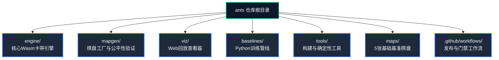
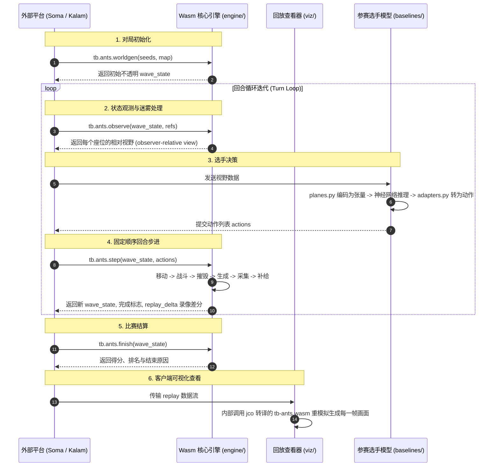

# TinyBrains Ants 仓库架构全景导读卡片手册

> **定位说明**：本手册专为快速理解仓库全景而设计。采用“自上而下、层层剥离”的卡片（Card）结构，不做冗长繁琐的代码罗列，直击每个文件与目录的**核心职责、输入输出与上下游协作关系**。

---

## 目录索引

1. [七大板块全景卡片总览](#1-七大板块全景卡片总览)
2. [engine/ 核心引擎层层剥离手册](#2-engine-核心引擎层层剥离手册)
   - [第一层：engine 根目录](#21-第一层engine-根目录)
   - [第二层：engine/src 核心源码](#22-第二层enginesrc-核心源码)
   - [第三层：engine/src/bin 辅助工具](#23-第三层enginesrcbin-辅助工具)
   - [第四层：engine/src/tests 测试矩阵](#24-第四层enginesrctests-测试矩阵)
3. [mapgen/ 棋盘工厂层层剥离手册](#3-mapgen-棋盘工厂层层剥离手册)
   - [第一层：mapgen 根目录与配方 recipes](#31-第一层mapgen-根目录与配方-recipes)
   - [第二层：mapgen/src 核心算法矩阵](#32-第二层mapgensrc-核心算法矩阵)
4. [viz/ 回放查看器层层剥离手册](#4-viz-回放查看器层层剥离手册)
   - [第一层：viz 根目录与构建门禁](#41-第一层viz-根目录与构建门禁)
   - [第二层：viz/src 前端查看器模块](#42-第二层vizsrc-前端查看器模块)
5. [baselines/ 训练管线层层剥离手册](#5-baselines-训练管线层层剥离手册)
   - [第一层：baselines 根目录与配置](#51-第一层baselines-根目录与配置)
   - [第二层：tb_baselines 核心算法](#52-第二层tb_baselines-核心算法)
   - [第三层：tb_baselines/train 训练算法与测试](#53-第三层tb_baselinestrain-训练算法与测试)
6. [tools/ 构建与验证工具卡片](#6-tools-构建与验证工具卡片)
7. [maps/ 基础棋盘与规格包络卡片](#7-maps-基础棋盘与规格包络卡片)
8. [.github/workflows/ CI发布流水线卡片](#8-githubworkflows-ci发布流水线卡片)
9. [全系统交互架构与数据流拓扑图](#9-全系统交互架构与数据流拓扑图)

---

## 1. 七大板块全景卡片总览



| 板块                                                                      | 核心语言      | 产出物 / 交付形式            | 职责一句话导读                                                  |
| ------------------------------------------------------------------------- | ------------- | ---------------------------- | --------------------------------------------------------------- |
| [`engine/`](file:///home/host/project/ants/engine)                       | Rust (wasm32) | `tb-ants.wasm` (ABI 1.0.0) | 决定所有对局规则、回合结算、迷雾视野与状态编解码，纯整数运算    |
| [`mapgen/`](file:///home/host/project/ants/mapgen)                       | Rust (Native) | CLI 工具 +`maps/*.json`    | 棋盘生成器，负责对称性数学计算、全群变换与 8 座位公平性扫描     |
| [`viz/`](file:///home/host/project/ants/viz)                             | JS / Node     | `dist/viz/` 前端应用包     | 基于 jco 转译的 Wasm 组件运行的单页面回放播放器与数据可视化图表 |
| [`baselines/`](file:///home/host/project/ants/baselines)                 | Python        | `tb_baselines` pip 库      | 将视野转化为 PyTorch 张量平面，提供启发式专家与 BC/PPO 训练流   |
| [`tools/`](file:///home/host/project/ants/tools)                         | Bash / Python | 构建/校验脚本                | 浮点数静态拦截 (`deny.sh`)、归档打包与跨版本逐回合对弈比对    |
| [`maps/`](file:///home/host/project/ants/maps)                           | JSON 数据     | 5 张基础基准棋盘             | 规定平台物理规格包络（2-8座位，24-124尺寸），由 mapgen 配方生成 |
| [`.github/workflows/`](file:///home/host/project/ants/.github/workflows) | YAML          | CI/CD 发布流                 | 运行门禁、生成官方 aarch64 引擎摘要、自动切出 Release 归档      |

---

## 2. engine/ 核心引擎层层剥离手册

`engine` 是 TinyBrains 的游戏卡带（game cartridge），编译为零 I/O 外部依赖的 WebAssembly 组件。

### 2.1 第一层：engine 根目录

```
engine/
├── Cargo.toml          # Rust 工作区配置与依赖声明
├── plugin.toml         # Orion 组件 ABI 规范源定义（5个导出函数）
├── about.json          # 游戏元数据简介（作者、规则概述）
└── src/                # 源码核心目录（下剥见 2.2）
```

#### 📇 [Card] `engine/Cargo.toml`

> **定位**：卡带的 Rust 依赖与编译器约束文件。

- 🎯 **主要职责**：定义 `tb_ants` crate；配置 `crate-type = ["cdylib", "rlib"]`；锁定依赖（serde, rand, base64 等）。
- 🔗 **关键关联**：与根目录 `rust-toolchain.toml` 配合，确保纯整数运算环境与 wasm32 目标一致。

#### 📇 [Card] `engine/plugin.toml`

> **定位**：平台组件 ABI 契约定义。

- 🎯 **主要职责**：声明 `tb.ants` 插件导出的 5 个函数签名及其参数字段（worldgen, observe, step, finish, replay-decode）。
- ⚠️ **注意事项**：此文件为手写源定义，经 `tools/package.py` 编译生成 `plugin.json`。对其任何修改都会改变引擎摘要。

#### 📇 [Card] `engine/about.json`

> **定位**：游戏的元数据介绍数据源。

- 🎯 **主要职责**：包含 Ants 游戏英文介绍，在构建时由 `manifest.rs` 合并入 `cartridge.json`。

---

### 2.2 第二层：engine/src 核心源码

以 `engine/src/` 为根，向下剥离出 10 个核心功能模块与 2 个子目录：

```
engine/src/
├── lib.rs              # 插件导出入口与 JSON 分发（无规则）
├── turn.rs             # 核心回合结算机（6大刚性结算阶段）
├── state.rs            # 单局状态运行时（蚂蚁ID分配、生命周期）
├── observe.rs          # 视野与战争迷雾生成（观察者相对坐标）
├── grid.rs             # 环面几何计算、对称性与伪随机数
├── maps.rs             # 棋盘数据加载与刚性合法性校验
├── food.rs             # 隐式速率食物生成与对称轨道分配
├── codec.rs            # 不透明 wave_state 的二进制紧凑编解码
├── replay.rs           # 动作流录制与可视化帧差分重模拟
├── authoring.rs        # 仅宿主：生成参考观测数据（不入 Wasm）
├── bin/                # 辅助可执行工具（下剥见 2.3）
└── tests/              # 严格的行为测试集（下剥见 2.4）
```

#### 📇 [Card] `engine/src/lib.rs`

> **定位**：插件对外唯一分发门户（API Gateway）。

- 🎯 **主要职责**：负责与宿主环境（Wasm ABI）交互，分发 5 大导出接口；负责 JSON 字符串与内部数据结构的序列化/反序列化；拦截 panic 保证健壮性。
- ⚠️ **规则铁律**：严禁在此文件写入任何游戏规则逻辑！规则全部委托给下层。

#### 📇 [Card] `engine/src/turn.rs`

> **定位**：游戏世界运转的核心心脏（Turn Resolution Engine）。

- 🎯 **主要职责**：严格按以下 6 个不可颠倒的阶段结算每一回合：
  1. `Move`（移动）：处理同时位移、碰撞判定与阻挡；
  2. `Attack`（战斗）：基于 2011 官方 Focus Battle 算法计算劣势并消灭蚂蚁；
  3. `Raze`（摧毁）：踩在敌方蚁穴上的蚂蚁摧毁该蚁穴；
  4. `Spawn`（生成）：存活蚁穴消耗食物储备生成新蚂蚁；
  5. `Gather`（采集）：移动到食物格子的蚂蚁采集食物入库；
  6. `Spawn Food`（补给）：按隐式速率补充食物。
- 🔗 **关键关联**：调用 `food.rs`、更新 `state.rs`、触发游戏终局判定与积分计算。

#### 📇 [Card] `engine/src/state.rs`

> **定位**：对局运行时数据结构仓库。

- 🎯 **主要职责**：维护单场比赛中存活蚂蚁列表、蚁穴状态、每个座位的 `next_id` 计数器、步数截止计数（cutoff counter）与比赛统计指标。
- 💡 **核心设计**：保证蚂蚁 ID 终身固定且按座位对称编号，即使被阻挡也永不丢失 ID。

#### 📇 [Card] `engine/src/observe.rs`

> **定位**：参赛选手视角发生器（Fog of War & Vision Generator）。

- 🎯 **主要职责**：计算战争迷雾（fog）、已知水域（known water）、可见视野掩码（`vis`）；将绝对坐标系转换为**观察者相对坐标系**（自己永远是 0 号，敌方按顺序相对排列）；输出与 `mine` 蚂蚁对齐的 `ids` 列表。
- ⚠️ **注意事项**：严禁向视野注入 `memory` 键，记忆属于宿主运行器维护内容。

#### 📇 [Card] `engine/src/grid.rs`

> **定位**：数学几何基石（Torus Topology & Math）。

- 🎯 **主要职责**：二维环面网格（左右/上下无缝环绕）的坐标折叠计算；曼哈顿距离与欧氏几何半径判定（视野、攻击、生成半径）；快速位图结构 `Bits`；确定性伪随机数生成器 `Rng`。
- ⚠️ **规则铁律**：全文件严格禁止浮点数，所有距离均以整数平方比较。

#### 📇 [Card] `engine/src/maps.rs`

> **定位**：棋盘解析器与连通性安全守卫。

- 🎯 **主要职责**：解析棋盘 JSON；执行刚性几何校验：平移对称性向量（shift）、蚁穴轨道完整性、陆地单连通可行走性（floodfill）、蚁穴无死锁出口。
- 🔗 **关键关联**：`worldgen` 创建对局时调用的第一道关卡，拒绝任何非法棋盘。

#### 📇 [Card] `engine/src/food.rs`

> **定位**：食物动态补给平衡系统。

- 🎯 **主要职责**：计算对局隐式食物生成速率；生成完全对称的食物点集合；执行公平打乱与待生成队列缓冲。

#### 📇 [Card] `engine/src/codec.rs`

> **定位**：状态密封仓（State Serialization）。

- 🎯 **主要职责**：将多局并发批次的 `wave_state` 序列化为紧凑高效的二进制字节串，并进行 Base64 编解码。
- 💡 **核心设计**：外部世界对其完全不透明，任何外部代码均不得尝试窥探其内部布局。

#### 📇 [Card] `engine/src/replay.rs`

> **定位**：极轻量对局录像与重放解密器。

- 🎯 **主要职责**：将对局动作流解码并重模拟为可视化动画帧数据；响应 `replay-decode` 请求，按帧或区间输出渲染差分。

#### 📇 [Card] `engine/src/authoring.rs`

> **定位**：仅在宿主环境使用的测试数据发生器。

- 🎯 **主要职责**：在基础棋盘上生成标准参考观测数据，供准入测试与模型特征面校验使用。在编译为 Wasm 时自动被链接器剥离。

---

### 2.3 第三层：engine/src/bin 辅助工具

```
engine/src/bin/
├── manifest.rs         # 生成 cartridge.json 基础清单
├── reference.rs        # 生成 reference/observations.json 参考观测数据
└── args/mod.rs         # bin 命令行工具共享的轻量参数解析模块
```

#### 📇 [Card] `engine/src/bin/manifest.rs`

> **定位**：卡带清单生成器。

- 🎯 **主要职责**：调用引擎自省信息，生成包含版本、ABI、适配器资源配额的初始 `cartridge.json`。

#### 📇 [Card] `engine/src/bin/reference.rs`

> **定位**：标准参考观测提取器。

- 🎯 **主要职责**：运行确定性种子生成基准测试观测切片，输出到 `dist/reference/observations.json`，供基线一致性测试作为真值对比。

---

### 2.4 第四层：engine/src/tests 测试矩阵

```
engine/src/tests/
├── rules.rs            # 核心游戏规则单元测试（移动碰撞、采食、生成）
├── spec.rs             # 2011 官方竞赛规范场景测试（Focus Battle 战斗验证）
├── ending.rs           # 比赛结束判定测试（灭绝、超时、得分终局）
├── maps.rs             # 棋盘加载与连通性验证测试
├── boards.rs           # 针对 maps/ 目录下 5 张已提交棋盘的合法性测试
├── ids.rs              # 蚂蚁 ID 终身唯一性与阻挡不丢失测试
├── food.rs             # 食物生成速率与对称性测试
├── observe.rs          # 视野、迷雾、已知水域、相对视角测试
├── events.rs           # 对局事件流记录测试
├── wave.rs             # 多场并发对局批处理步进测试
├── replay.rs           # 回放重模拟、逐帧差分与解码测试
├── equivalence.rs      # 多次重跑完全逐位确定性一致测试
├── fixtures/           # 真实对局录像测试用例 fixture
└── mod.rs              # 测试模块统一组织与辅助桩代码
```

---

## 3. mapgen/ 棋盘工厂层层剥离手册

`mapgen` 是宿主专用工具（不编译进 Wasm），负责制作完全对称、绝对公平且具有战略深度的棋盘。

### 3.1 第一层：mapgen 根目录与配方 recipes

```
mapgen/
├── Cargo.toml          # mapgen 工具的依赖（serde, toml, rand, image等）
├── recipes/            # 5 张基础棋盘的 TOML 原始设计配方
│   ├── basic-tiny-2p.toml
│   ├── basic-small-3p.toml
│   ├── basic-medium-4p.toml
│   ├── basic-large-6p.toml
│   └── basic-xlarge-8p.toml
└── src/                # 生成器源码（下剥见 3.2）
```

#### 📇 [Card] `mapgen/recipes/*.toml`

> **定位**：棋盘的“DNA”描述配方。

- 🎯 **主要职责**：声明棋盘高宽、座位数、点群对称性（如四重旋转或平移轨道）、洞穴/房间参数、各区域随机种子与食物配给。
- ⚠️ **规则铁律**：棋盘是数据，永远不要手工编辑 `maps/*.json`，必须修改配方后重新生成。

---

### 3.2 第二层：mapgen/src 核心算法矩阵

```
mapgen/src/
├── main.rs             # CLI 命令行入口与子命令调度
├── design.rs           # 配方渲染器（应用全群变换、生成陆地、修饰水系与放置蚁穴）
├── sym.rs              # 环面群论数学（座位平移向量、点群、对称轨道分解）
├── sample.rs           # 参数采样器（根据槽位规则随机探索候选方案）
├── explore.rs          # 批量设计探索与交互式候选池打分
├── sweep.rs            # 对称公平性扫描仪（证明所有座位完全对等）
├── play.rs             # 自动化同构对弈试玩（贪心寻路机器人）
├── measure.rs          # 棋盘品质指标度量（开阔度、瓶颈宽度、最短路径）
├── recipe.rs           # 配方结构体定义与 TOML 序列化支持
├── make.rs             # 地貌雕刻器（元胞自动机洞穴、房间生成）
├── set.rs              # 离散单元格集合运算与引擎桥接验证
├── grid.rs             # mapgen 专用的环面几何工具类
└── tests.rs            # 保证已提交棋盘与配方逐字节一致的回归测试
```

#### 📇 [Card] `mapgen/src/design.rs`

> **定位**：棋盘工艺渲染核心（The Master Renderer）。

- 🎯 **主要职责**：将 TOML 配方翻译为真实网格。执行全群几何变换、雕刻陆地与水域、挖掘连通走廊、在对称中心安放蚁穴并预留安全距离、布置初始食物。

#### 📇 [Card] `mapgen/src/sweep.rs`

> **定位**：终极公平性证明机（Fairness Proof Engine）。

- 🎯 **主要职责**：在候选棋盘上让所有座位运行完全相同的对称镜像策略，如果规则或棋盘存在哪怕一个格子的微小不对称，对局就会产生分歧并报错。

#### 📇 [Card] `mapgen/src/sym.rs`

> **定位**：群论几何求解器。

- 🎯 **主要职责**：计算环面上任意座位的平移偏移量 `shift`，将棋盘划分为互不重叠的等价对称轨道（Orbits）。

---

## 4. viz/ 回放查看器层层剥离手册

`viz` 是独立的前端组件包，用于在 Web 端和手册中以 60 FPS 渲染流畅的对战重放。

### 4.1 第一层：viz 根目录与构建门禁

```
viz/
├── build.sh            # 调用 jco 将 tb-ants.wasm 转译为 JS 模块，打包查看器
├── check.mjs           # 严格的门禁检查（检查 CSS 前缀隔离、校验几何尺寸）
├── make-last-frame.mjs # 运行真实对局生成终局固件帧
├── last-frame-basic-xlarge-8p.json # 固件参照文件（校验查看器与引擎一致性）
├── README.md           # 查看器挂载 API (mount) 说明手册
└── src/                # 查看器核心组件（下剥见 4.2）
```

#### 📇 [Card] `viz/check.mjs`

> **定位**：查看器安全检查守卫。

- 🎯 **主要职责**：静态扫描 CSS 规则必须带 `.tb-viz` 前缀（防止污染宿主网站全局样式）；检查固件摘要是否与当前引擎严格一致。

---

### 4.2 第二层：viz/src 前端查看器模块

```
viz/src/
├── index.js            # 对外暴露的主入口（导出 mount() 方法）
├── shell.js            # 播放器 UI 外壳（控制栏、进度条、比分板、倍速调节）
├── render.js           # HTML5 Canvas 核心渲染引擎（蚂蚁动画、战斗特效、战争迷雾）
├── engine.js           # 客户端 Wasm 引擎桥接层（调用转译后的 Wasm 进行帧解密）
├── map.js              # 小地图与视口缩放平移控制器
├── graph.js            # 实时数据折线图（各方蚂蚁数量与领地走势）
└── react.js            # 仅供 React 宿主使用的可选封装组件
```

#### 📇 [Card] `viz/src/render.js`

> **定位**：高帧率 Canvas 渲染核心。

- 🎯 **主要职责**：在 HTML5 Canvas 上绘制环面网格、地形、蚂蚁行走补间动画、攻击连线特效、蚁穴爆炸动画以及视野迷雾遮罩。

#### 📇 [Card] `viz/src/engine.js`

> **定位**：单一引擎原则的客户端践行者。

- 🎯 **主要职责**：绝不通过 JS 重新实现游戏规则，而是封装调用 jco 转译的 `tb_ants.wasm` 执行动作重模拟，确保与平台判定 100% 同构。

---

## 5. baselines/ 训练管线层层剥离手册

`baselines` 为参赛者和平台提供模型训练流水线，将引擎观测转化为神经网络特征平面。

### 5.1 第一层：baselines 根目录与配置

```
baselines/
├── pyproject.toml      # Python 包元数据定义（tb_baselines）
├── classes.toml        # 参赛模型规格分级（nano, micro 等参数上限）
├── games.toml          # TinyBrains 平台对局与模型绑定配置
├── src/tb_baselines/   # 算法与模型核心库（下剥见 5.2）
└── tests/              # 格式准入与一致性门禁测试（下剥见 5.3）
```

---

### 5.2 第二层：tb_baselines 核心算法

```
baselines/src/tb_baselines/
├── planes.py           # 核心：将引擎视野字典编码为 2D 空间特征张量平面
├── adapters.py         # 适配器：将神经网络预测的概率分布解码为动作字符
├── env.py              # 强化学习向量化交互环境（Gym/PettingZoo 风格）
├── teacher.py          # 启发式贪心专家机器人（用于行为克隆教学）
├── nets.py             # PyTorch 神经网络架构（ConvNet, ResNet, Actor-Critic）
├── export.py           # 模型导出与 ONNX 转换固化工具
├── collect.py          # 自对弈与轨迹数据收集器
├── eval.py             # 机器人评测对决与天梯排位估算工具
└── train/              # 训练算法目录（下剥见 5.3）
```

#### 📇 [Card] `tb_baselines/planes.py`

> **定位**：感知特征工程核心（Spatial Feature Encoder）。

- 🎯 **主要职责**：将 `engine/src/observe.rs` 输出的视野转换为通道张量：通道 0=己方蚂蚁，通道 1=敌方蚂蚁，通道 2=已知食物，通道 3=已知水域，通道 4=迷雾掩码等。
- ⚠️ **规则铁律**：若引擎视野字段有调整，必须在此处同步修改特征平面映射！

#### 📇 [Card] `tb_baselines/teacher.py`

> **定位**：规则型启发式专家（BFS Heuristic Bot）。

- 🎯 **主要职责**：基于广度优先搜索（BFS）实现的高性能巡逻、采食与避障专家，用于为模仿学习生成高质量训练轨迹。

---

### 5.3 第三层：tb_baselines/train 训练算法与测试

```
baselines/src/tb_baselines/train/
├── bc.py               # 行为克隆（Behavioral Cloning）监督学习训练器
├── ppo.py              # PPO（Proximal Policy Optimization）强化学习训练器
└── seq.py              # 循环神经网络与序列时序模型训练器

baselines/tests/
├── test_adapter_conformance.py  # 核心门禁：验证导出 ONNX 严格满足平台准入
├── test_env.py                  # 强化学习环境步进测试
└── test_teacher.py              # 启发式专家行为正确性测试
```

---

## 6. tools/ 构建与验证工具卡片

`tools/` 存放整个构建流程所依赖的独立脚本：

```
tools/
├── deny.sh             # 确定性审查：正则扫描 engine/src/ 杜绝任何浮点数
├── package.py          # 构建收尾：补全 dist/ 下的 manifest、limits 与 maps 目录
├── pack.py             # 确定性归档：将 dist/ 压缩为标准 tar.gz 并生成发布 tag
└── equivalence.py      # 等价性验证：两个 dists 运行相同种子对战逐回合精确比对
```

#### 📇 [Card] `tools/deny.sh`

> **定位**：浮点运算一票否决机。

- 🎯 **主要职责**：在每次构建最前端运行，扫描 `engine/src/` 中是否存在 `f32`、`f64`、`sqrt`、`pow` 或带小数点的字面量，发现即立刻终止构建。

#### 📇 [Card] `tools/equivalence.py`

> **定位**：重构安全卫士（Parity Verification）。

- 🎯 **主要职责**：在新版构建与已发布的旧版之间，使用相同的随机种子分别运行随机策略和贪心策略，逐回合对比全部视野、得分与终局，确保重构没有偷偷改变任何既有规则。

---

## 7. maps/ 基础棋盘与规格包络卡片

```
maps/
├── basic-tiny-2p.json      # 24 × 24，2 座位（微型快速验证）
├── basic-small-3p.json     # 36 × 36，3 座位（旋转不对称博弈）
├── basic-medium-4p.json    # 48 × 64，4 座位（标准经典竞技场）
├── basic-large-6p.json     # 80 × 96，6 座位（大型混战）
└── basic-xlarge-8p.json    # 120 × 124，8 座位（全平台包络上限）
```

#### 📇 [Card] `maps/` 规格矩阵卡片

> **定位**：平台的物理边界与合规性度量衡（The Platform Envelope）。

- 🎯 **主要职责**：
  - 最小尺寸：`24 × 24`，最大尺寸：`120 × 124`；
  - 座位数覆盖：`2` 到 `8` 座位；
  - 单元格上限：`14,880` 块；
  - 平台规则：任何线上赛季自定义棋盘，其长宽和座位数都必须落在该包络矩阵之内，否则直接被平台拒绝。

---

## 8. .github/workflows/ CI发布流水线卡片

```
.github/workflows/
└── build.yml           # 平台自动化构建、测试与发版总流水线
```

#### 📇 [Card] `.github/workflows/build.yml`

> **定位**：官方发布权威源泉（Single Source of Release Truth）。

- 🎯 **主要职责**：
  1. 在 `ubuntu-24.04-arm` 运行器上统一构建，生成官方认可的 `tb-ants.wasm` 引擎摘要；
  2. 运行 `deny.sh`、Rust 单元测试、mapgen 测试、baselines 一致性测试；
  3. 使用当前构建的卡带运行真实比赛；
  4. 触发 `publish=true` 时，生成正式 Release 归档并打上 `engine-<12位哈希>` 标签。

---

## 9. 全系统交互架构与数据流拓扑图


